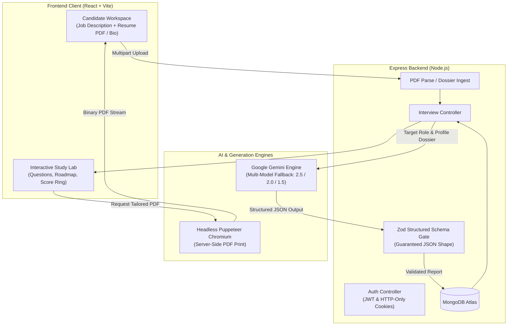
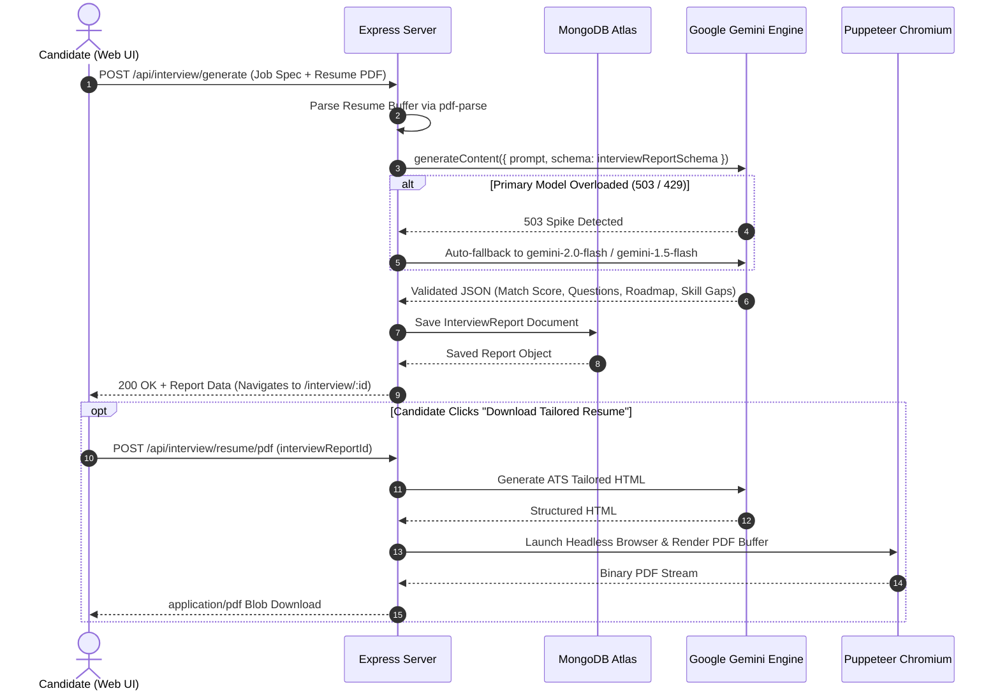

# ⚡ QraftAI

> **From target job spec to interview-ready. AI strategy, targeted problem drills, and ATS-tailored resume generation.**

[](#)
[](#)
[](#)
[](#)
[](#)

[🚀 Quick Start](#-quick-start) &bull; [🧩 How It Works](#-how-it-works) &bull; [💡 What It Does](#-what-it-does) &bull; [⚙️ API Workflow](#️-api-workflow)

---

## 💡 What It Does

**QraftAI** is an interview preparation workspace built for developers. Instead of generic advice, QraftAI parses target job descriptions, evaluates candidate resumes or technical profiles, and dynamically synthesizes:

- **Targeted Technical Problems**: Role-specific algorithmic, architectural, and core engineering questions paired with interviewer intention and optimal model answers.
- **Behavioral Scenarios**: Tailored STAR-method question sets addressing team dynamics, conflict resolution, and ownership.
- **Day-by-Day Preparation Roadmap**: A structured study timeline modeled after industry interview sheets (DSA, System Design, Mock Rehearsals).
- **Match Score & Skill Gap Radar**: Accurate compatibility percentages and high/medium/low severity skill gaps.
- **ATS-Tailored Resume PDF Generator**: One-click generation and download of an ATS-compliant resume aligned directly with the target job requirements.

---

## 🧩 How It Works



> **The key design rule:** The analysis gate computes match scores, targeted technical questions, and skill gaps strictly against verified job criteria and structured candidate dossiers, never through ungrounded hallucinations.

---

### What happens when a candidate requests an interview plan



---

## 🛠️ Core Tech Stack

- **Frontend**: React 19, Vite, SCSS (LeetCode-inspired study theme), React Router
- **Backend**: Node.js, Express.js
- **Database**: MongoDB with Mongoose
- **AI & Processing**: Google Gemini API (`@google/genai`) with automatic multi-model failover
- **Document Engine**: Puppeteer (server-side headless PDF generation) & `pdf-parse` (resume parsing)
- **Validation**: Zod & `zod-to-json-schema`

---

## 🚀 Quick Start

### 1. Prerequisites
- Node.js (v18 or higher recommended)
- MongoDB Database (Local or Atlas cluster)
- Google Gemini API Key ([Google AI Studio](https://aistudio.google.com/))

### 2. Environment Configuration
Create a `.env` file in the root directory:

```env
PORT=3000
MONGODB_URI=your_mongodb_connection_string
JWT_SECRET=your_jwt_secret_key
GEMINI_API_KEY=your_gemini_api_key
FRONTEND_URL=http://localhost:5173
```

In `Frontend/`, create `.env`:
```env
VITE_API_URL=http://localhost:3000
```

### 3. Installation & Run

**Terminal 1 — Backend:**
```bash
npm install
node server.js
```

**Terminal 2 — Frontend:**
```bash
cd Frontend
npm install
npm run dev
```

Visit `http://localhost:5173` to start preparing.


